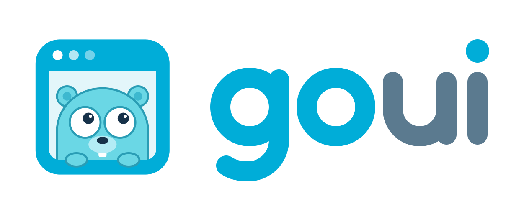
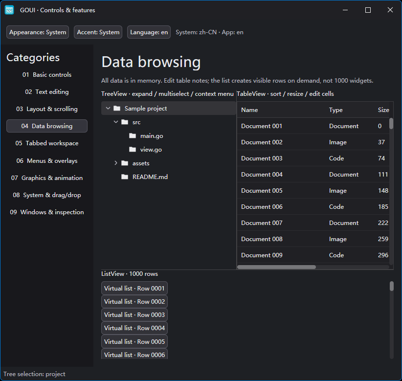
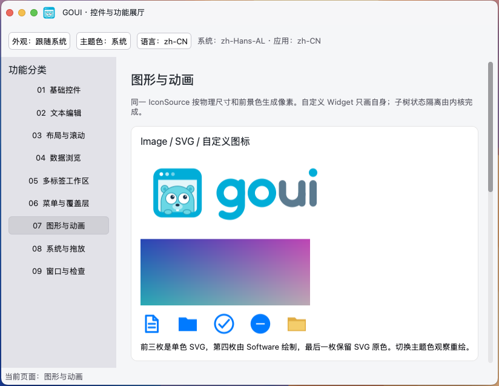
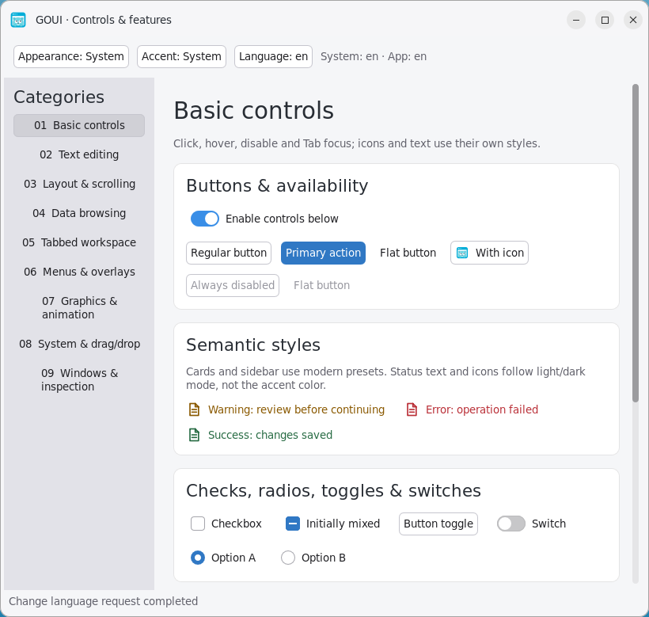

<p align="center">
  
</p>

<h1 align="center">Build lightweight, modern desktop apps in Go—no GCC required</h1>

<p align="center">
  <a href="doc/README_CN.md">中文</a>
</p>

GOUI is a native GUI framework written entirely in Go. Build both your interface and application logic in Go, without a browser engine or a C/C++ build toolchain.

The current version provides the foundations and controls needed for small desktop applications; public APIs are still evolving.

## Related projects

| Project | Purpose |
| --- | --- |
| [goui-sourceview](https://github.com/golang-gui/goui-sourceview) | Code editor extension with syntax highlighting, completion, bracket matching, and find/replace. |
| [applesdk](https://github.com/golang-gui/applesdk) | Pure Go macOS SDK bindings for services including StoreKit, iCloud, and CloudKit. |

## Try the demo

The [demo](example/demo) brings together controls, text editing, layouts, data views, detachable
tabs, overlays, graphics, animations, and system integration. Switch between light/dark appearances, accent colors, and eight UI languages.

| Platform | Demo download |
| --- | --- |
| Windows x64 | [Download EXE](https://github.com/golang-gui/goui/releases/download/v0.1.0/goui-demo-v0.1.0-windows-amd64.exe) |
| macOS Apple Silicon | [Download .app ZIP](https://github.com/golang-gui/goui/releases/download/v0.1.0/goui-demo-v0.1.0-darwin-arm64.zip) |
| Linux x64 / X11 | [Download executable](https://github.com/golang-gui/goui/releases/download/v0.1.0/goui-demo-v0.1.0-linux-amd64) |

See the [v0.1.0 release notes](https://github.com/golang-gui/goui/releases/tag/v0.1.0) and
[SHA-256 checksums](https://github.com/golang-gui/goui/releases/download/v0.1.0/SHA256SUMS).
On Linux, run `chmod +x goui-demo-v0.1.0-linux-amd64` before launching it.
On macOS, extract and open `GOUI Demo.app`; the bundle is Developer ID signed and Apple-notarized, with the notarization ticket stapled.

Windows



macOS



Linux



To run the current source from the repository root:

```sh
CGO_ENABLED=0 go run ./example/demo
```

## Why GOUI?

- **No cgo, no GCC.** Build with `CGO_ENABLED=0` using the Go toolchain, including cross-compilation for supported targets. Native APIs are bound at runtime; building your application does not require a C/C++ compiler.
- **One binary, one app.** Embed icons and other assets with Go's `embed` package. Windows executables and Linux binaries can run directly; macOS can wrap the executable in an `.app` for application identity, icons, and signing.
- **Modern appearance, native integration.** A consistent Modern stylesheet with light/dark modes and accent colors, paired with native window chrome, fonts, text layout, IME, clipboard, and file dialogs.
- **AI-friendly.** Semantic snapshots describe the widget tree. The `gui/dev` adapter supports inspecting windows and popovers, dispatching input, and committing text for debugging and AI automation.

Single-binary delivery does **not** mean there are no system dependencies. GOUI loads native system libraries at runtime. See [platforms and dependencies](#platforms-and-dependencies) for requirements.

### Standing on the shoulders of giants

GOUI learns from mature frameworks rather than inventing every mechanism:

[GTK4](https://docs.gtk.org/gtk4/) for widgets and event controllers, [Flutter](https://docs.flutter.dev/ui/layout/constraints) for constraint-based layout, [Qt](https://doc.qt.io/) and [Avalonia](https://docs.avaloniaui.net/) for desktop integration, and [SwiftUI](https://developer.apple.com/documentation/swiftui) for declarative composition. The result remains Go-shaped, not an imitation of any one framework.

Rendering builds on native Direct2D/DirectWrite, Core Text, and Pango/Cairo, alongside the project's [NanoVG Go fork](https://github.com/golang-gui/nanovgo). SVG support uses the project's [oksvg fork](https://github.com/golang-gui/oksvg). GOUI keeps these foundations behind clear platform, widget, and declarative layers.

## Size and memory

GOUI is a lightweight native GUI framework. Actual executable size and runtime memory usage depend on the application and rendering backend.

### Executable size

Built with Go 1.25.8, `CGO_ENABLED=0`, `-trimpath`, and `-ldflags="-s -w"`, with `-H=windowsgui` also set on Windows.

| Target | Minimal app | Demo |
| --- | ---: | ---: |
| Windows amd64 | 4.58 MiB | 8.56 MiB |
| macOS arm64 | 4.75 MiB | 8.26 MiB |
| Linux amd64 | 4.46 MiB | 8.43 MiB |

The full demo includes its logo, SVG icons, eight-language resources, and nine feature pages. Windows includes generated icon and version resources. These figures are from development builds, not published release artifacts; `.app` metadata, installer/archive overhead, and system libraries are not included.

### Process memory usage

| Application | RSS | PSS |
| --- | ---: | ---: |
| Minimal app | 58.8 MiB | 28.6 MiB |
| Demo | 78.5 MiB | 46.2 MiB |

RSS includes resident shared-library pages; PSS apportions shared pages between processes. The figures are summed from Linux `/proc/<pid>/smaps` and are provided for reference; results on other platforms may differ.

## What you can build with today

- **Controls:** buttons, labels, images/icons, text inputs, multi-line text views, menus, dropdowns, check/radio/toggle buttons, switches, and linear/circular progress indicators.
- **Layout and data:** horizontal/vertical boxes, wrapping, baseline alignment, scrolling, overlays, split views, virtualized lists, tree views, and tables with custom cells, sortable headers, and resizable columns.
- **Workspaces:** tabs with close requests and context menus, drag reordering, transfers between windows, and detaching into new windows.
- **Input:** Unicode editing, CJK IME, selection, undo/redo, clipboard, shortcuts, Tab focus navigation, and drag and drop within and across applications.
- **Appearance:** Modern light/dark styles, accent and semantic colors, SVG and style-aware icons, HiDPI, transparency, shadows, and custom widget painting.
- **Application facilities:** timers on the GUI thread, frame-driven numeric animation, system settings, eight-language framework resources, file dialogs and access credentials, and opening URLs/files through system handlers.

Core controls live in `gui`, with declarative bindings in `ui`. Additional controls live in `widgets`, with their declarative bindings in `widgets/ui`.

## Build with an AI coding assistant

The [GOUI application development Skill](skills/goui-app/SKILL.md) guides your AI through
GOUI APIs, state, layout, styles, resources, building, and debugging. To install it, tell your AI:

> Install the GOUI application development skill following https://github.com/golang-gui/goui/blob/main/skills/INSTALL.md.

The AI follows the [installation instructions](skills/INSTALL.md) using its tool's native
skill mechanism; no GOUI-specific Agent adapter or manual file copying is required.
Tools without Skill support can read the guide directly, but this is not a native installation.
Installing the Skill does not install or upgrade your application's GOUI dependency.

For code editor integration and customization, use the
[SourceView application development Skill](https://github.com/golang-gui/goui-sourceview/blob/main/skills/goui-sourceview-app/SKILL.md),
maintained in the SourceView repository with its own [installation guide](https://github.com/golang-gui/goui-sourceview/blob/main/skills/INSTALL.md).

For reusable components and custom controls, see [Custom Widget and View](doc/CustomWidgetView.md)
for composing, extending, and implementing both layers.

## Quick start

Requires **Go 1.24 or newer** and a supported desktop environment. Create a module and add GOUI:

```sh
mkdir hello-goui
cd hello-goui
go mod init example.com/hello-goui
go get github.com/golang-gui/goui@latest
```

Save as `main.go`:

```go
package main

import (
    "fmt"
    "log"

    "github.com/golang-gui/goui/theme/modern"
    "github.com/golang-gui/goui/ui"
)

func main() {
    count := ui.MakeState(0)
    err := ui.Run("com.example.Hello", func(app ui.App) ui.RootView {
        return ui.Root().
            StyleSheet(modern.FromSettings(app.Settings())). // Use the Modern theme
            Windows(
                ui.Window("main").
                    Title("Hello GOUI").
                    Size(480, 240).
                    Content(
                        ui.VBox(
                            ui.Label(fmt.Sprintf("Clicked %d times", count.Get())),
                            ui.Button("Click me").OnClick(func() {
                                // Prefer Update to count.Set(count.Get() + 1):
                                count.Update(func(old int) int {
                                    return old + 1
                                })
                            }),
                        ).Spacing(12).Padding(20),
                    ),
            )
    })
    if err != nil {
        log.Fatal(err)
    }
}
```

Build and run on your current platform:

```sh
CGO_ENABLED=0 go build -trimpath -ldflags="-s -w" -o hello-goui .
./hello-goui
```

On Windows PowerShell, use `$env:CGO_ENABLED='0'`, then run:

`go build -trimpath -ldflags="-s -w -H=windowsgui" -o hello-goui.exe .`.

Views are ordinary Go values. `State.Set` and `State.Update` request a coalesced rebuild. System settings changes also rebuild this example, updating its Modern stylesheet. For larger applications, compose views with functions or custom view types, or implement widgets using `gui.WidgetBase`.

## Platforms and dependencies

| Platform / current release target | Window system | Drawing backends | Text layout |
| --- | --- | --- | --- |
| Windows / amd64 | Win32 | Direct2D, OpenGL, Software | DirectWrite |
| macOS / arm64 | AppKit | OpenGL, Software | Core Text |
| Linux / amd64 | X11 | OpenGL, Software | Pango / Cairo |

On Windows and macOS, native frameworks are supplied by the operating system. On Linux, the current backend needs an X11 display server; Wayland sessions need XWayland, and window behavior still needs validation on the target desktop. Runtime libraries include X11/Xext/Xrender/Xrandr/Xcursor, GL/GLX, GLib/GIO, Fontconfig, and Pango/Cairo.
Settings integration and native file dialogs use GTK. No development headers or C compiler are needed.
Linux Integrated decoration additionally needs a compositor; otherwise GOUI can fall back to native decoration.

You can select a drawing backend with `GOUI_PLAT_PAINTER=software` or `opengl`; Windows also accepts `direct2d`. See the [demo guide](example/demo/README.md) for platform details.

### Build and package

Ordinary `go build` is sufficient to build an application. The optional [`cmd/goui`](cmd/goui/README.md) tool handles platform resources and packaging from `goui.toml`: Windows icon/version resources, macOS Info.plist/ICNS/`.app` and explicit signing, and Linux desktop/icon resources.
These steps do not require GCC; macOS signing uses the platform's `codesign` tool.

For example, build the demo and its platform resources:

```sh
CGO_ENABLED=0 go run ./cmd/goui build -config example/demo/goui.toml -ldflags="-s -w"
```

## Environment variables

These are usually unnecessary. Set them before launching the application for startup configuration, debugging, or compatibility checks. Restart the application after changing them; they are not runtime switching interfaces.

| Variable | Purpose and values | Default behavior |
| --- | --- | --- |
| `GOUI_PLAT_SCALE` | Overrides the logical-unit-to-physical-pixel scale; fractional values such as `1`, `1.5`, and `2` are supported | Uses the platform's system scale; an unset, unparseable, or non-positive value does not override it |
| `GOUI_PLAT_PAINTER` | Selects a drawing backend: `opengl`, `software`; Windows also accepts `direct2d` | Uses the platform's default backend and initialization fallback policy |

`GOUI_PLAT_SCALE=2` means 1 DIP maps to 2 physical pixels. It does not change the operating system's display settings or replace HiDPI testing on real devices.

Backend names are lowercase. An unset or unrecognized name uses the default:

- **Windows:** Direct2D by default, falling back to OpenGL and then Software if initialization fails.

  Specifying `direct2d` follows the same sequence; explicitly selecting `opengl` does not fall back and returns an error if initialization fails.

- **Linux / macOS:** OpenGL by default, falling back to Software if initialization fails. Specifying `opengl` follows the same policy.

- Specifying `software` selects software rendering directly. These fallbacks occur during backend initialization, not automatically while the app is running.

Linux / X11 also recognizes these compatibility variables:

| Variable | Purpose |
| --- | --- |
| `GDK_SCALE` | Sets a scale such as `1` or `2`; precedence is `GOUI_PLAT_SCALE` > `GDK_SCALE` > desktop DPI settings |
| `XCURSOR_THEME` | Selects an installed cursor theme, overriding the desktop cursor theme setting |
| `XCURSOR_SIZE` | Sets the cursor size in positive integer pixels, such as `24` or `32`, overriding the desktop cursor size setting |

For example, launch the software-rendered demo at 2x from the repository root using Bash:

```sh
CGO_ENABLED=0 GOUI_PLAT_PAINTER=software GOUI_PLAT_SCALE=2 go run ./example/demo
```

Windows PowerShell:

```powershell
$env:CGO_ENABLED = '0'
$env:GOUI_PLAT_PAINTER = 'direct2d'
$env:GOUI_PLAT_SCALE = '1.5'
go run ./example/demo
```

Variables in the Bash example apply only to that command; those in the PowerShell example remain set in the current terminal session.
To restore automatic selection, remove the relevant variables and restart the application. For example, in PowerShell:
`Remove-Item Env:GOUI_PLAT_PAINTER, Env:GOUI_PLAT_SCALE -ErrorAction SilentlyContinue`.

### Optional development tools

`GOUI_DEV_ADDR` is the listening address for the [`gui/dev`](gui/dev) development adapter, not a platform rendering setting.
First add `import _ "github.com/golang-gui/goui/gui/dev"` to the application, then set the variable to enable the service.
It does not start unless the package is imported and the variable is set. For an application that already imports the package:

```sh
GOUI_DEV_ADDR=127.0.0.1:8888 ./your-app
```

The service provides semantic snapshots, input event dispatch, and text submission. Use it only for local development; enabling it in production is not recommended.

## A small, layered design

```text
ui        Declarative views and explicit update coordination
gui       Widgets, layout, painting, events, focus, signals, and snapshots
platform  Native windows, event loops, input, drawing, and typography
```

Use only the layers you need. `animation`, `layout`, `style`, `icon`, and `mlang` provide focused capabilities; `gui/dev` is an opt-in debugging adapter. GOUI aims to be a practical GUI toolkit, not a browser or an all-purpose platform SDK.

## Roadmap

- Add touch input and gestures while keeping mouse/keyboard use first-class.
- Support more platforms, architectures, and window systems.
- Add more purpose-built controls and reusable application components.
- Keep optimizing performance and memory use, backed by reproducible measurements.

## License and acknowledgements

GOUI is [MIT licensed](LICENSE). Dependencies retain their own licenses.

The [logo](doc/logo/goui-mark.svg) retains attribution to the Go gopher by Renee French (CC BY 4.0).
